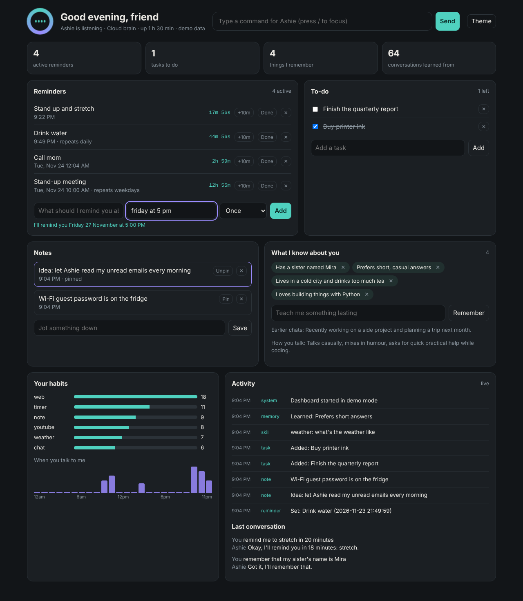
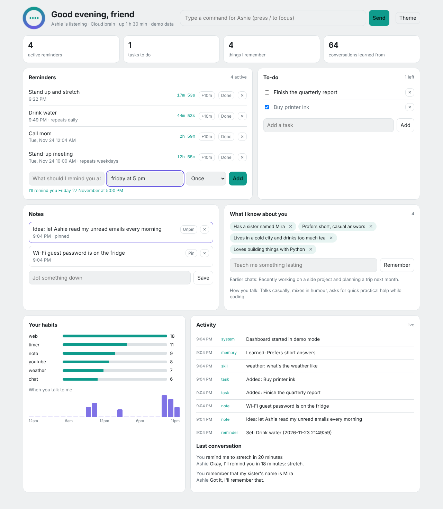
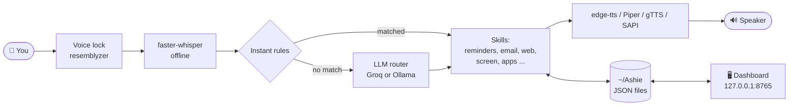

<div align="center">

# 🎙️ Ashie

**A free, local-first voice assistant for your Windows PC, with a live dashboard.**
Say her name, and she opens apps, writes emails, reads your screen, sets reminders and remembers who you are.


[Quick start](#-quick-start) · [Dashboard](#-the-dashboard) · [Features](#-features) · [Voice commands](#-voice-commands) · [Configuration](#%EF%B8%8F-configuration) · [Troubleshooting](#-troubleshooting)



</div>

---

## ✨ Why Ashie?

- 🔒 **Private by default.** Speech recognition, voice lock, OCR and memory all run on your machine.
- 🧠 **Smart when online, still useful offline.** Uses Groq's free cloud models first, falls back to a local [Ollama](https://ollama.com) model.
- 🗣️ **Only obeys you.** An offline voiceprint check ignores other people (and your TV).
- 💾 **She remembers.** Lasting facts, a rolling summary of older chats, and semantic recall of old conversations.
- 🖥️ **A dashboard that updates live.** Reminders, notes, to-dos, memory, habits and an activity feed in one place.
- 💸 **Free.** No subscriptions. The only optional key is a free Groq key.

## 🚀 Quick start

> **You need:** Windows 10/11, Python 3.10 or newer, a microphone, and (optional) internet for the cloud brain and online voice.

```powershell
# 1. Get the code
git clone https://github.com/<your-username>/ashie.git
cd ashie

# 2. (Recommended) create a virtual environment
python -m venv .venv
.venv\Scripts\activate

# 3. Install dependencies
pip install -r requirements.txt
pip install -U edge-tts        # always run this once, see Troubleshooting

# 4. First-time setup: your name, city, etc.
python ashie.py --setup

# 5. (Optional but recommended) add the free cloud brain
python ashie.py --set-groq-key

# 6. Run her
python ashie.py
```

On the first run Ashie asks you to read 3 short phrases so she can learn your voice. Then say **"Ashie, hello"** or press **F8**.

<details>
<summary><b>👀 Just want to see the dashboard first? (no microphone needed)</b></summary>

```powershell
python dashboard.py --demo
```

Opens the dashboard with sample reminders, notes and memories in a temporary folder. Nothing touches your real data.
</details>

<details>
<summary><b>🔑 Getting a free Groq key (cloud brain)</b></summary>

1. Create a free account at [console.groq.com](https://console.groq.com) and make an API key.
2. Run `python ashie.py --set-groq-key` and paste it. Ashie saves it to `~/Ashie/groq_key.txt` and tests it.
3. Or set the `GROQ_API_KEY` environment variable instead.

The key is never stored in the code or the repo.
</details>

<details>
<summary><b>🏠 Setting up the offline brain (Ollama)</b></summary>

1. Install [Ollama](https://ollama.com/download).
2. That's it. Ashie starts Ollama only when needed, pulls the model in the background the first time, and shuts Ollama down when idle.
3. Change models with `llm_model` and `code_model` in your config (defaults: `qwen2.5:3b`, about 2 GB of VRAM, and `qwen2.5-coder:3b`).
</details>

<details>
<summary><b>🔊 Optional: natural offline voice (Piper)</b></summary>

Online, Ashie uses Microsoft's free neural voices (edge-tts). For a natural-sounding voice when you're offline:

1. Download `piper.exe` from the [Piper releases](https://github.com/rhasspy/piper/releases).
2. Download a voice (the `.onnx` and `.onnx.json` files, e.g. `en_GB-jenny_dioco-medium`) from the [Piper voices](https://huggingface.co/rhasspy/piper-voices) page.
3. Put them in `%USERPROFILE%\Ashie\piper\`.

If they're missing, Ashie quietly falls back to the built-in Windows voice.
</details>

## 📊 The dashboard

Ashie starts a small web server on **<http://127.0.0.1:8765>** (only reachable from your own computer). Open it in any browser, or say **"Ashie, open dashboard"**.

| Panel | What it does |
|---|---|
| **Orb and status** | Shows whether she's listening, thinking or speaking, which brain is active, and uptime. |
| **Command bar** | Type a command instead of speaking it. Press `/` or `Ctrl+K` to focus. |
| **Reminders** | Live countdowns, snooze (+10m), done, undo and delete. Add one with plain English such as *"tomorrow at 9"* and see how she understood it before you save. Supports daily, weekday and weekly repeats. |
| **To-do** | Tick tasks off. Add by voice or by typing. |
| **Notes** | Everything you tell her to note down, with pinning. |
| **What I know about you** | Facts she has learned. Add or forget them with one click, and read her summary of older chats. |
| **Habits** | Your most-used skills and the hours you talk to her most. |
| **Activity** | A live feed of what she just did, plus the last few exchanges. |

Everything is two-way: **say** "remind me to call mom at 6" and it appears on the dashboard; **add** a reminder on the dashboard and she speaks it out loud when it's due. Light and dark themes are supported (button in the top right).

<div align="center">

</div>

<details>
<summary><b>Dashboard options</b></summary>

| Setting (in `config.json`) | Default | Meaning |
|---|---|---|
| `dashboard_enabled` | `true` | Start the dashboard with Ashie. |
| `dashboard_port` | `8765` | Change if the port is busy. |
| `dashboard_open_browser` | `false` | Open it in your browser on every start. |

Run Ashie without it once with `python ashie.py --no-dashboard`.
Run only the dashboard (to edit reminders and notes while Ashie is off) with `python dashboard.py`.

**Security:** it binds to `127.0.0.1`, rejects foreign `Host` headers, and requires a custom header on every change request, so other websites can't drive it.
</details>

## 🧰 Features

| | Skill | Example |
|---|---|---|
| ⏰ | **Reminders and timers** (saved to disk, survive restarts) | "Remind me to take a break in 30 minutes" |
| 📝 | **Notes and to-do list** | "Take a note: ideas for the weekend" |
| 🧠 | **Long-term memory** | "Remember that my sister's name is Mira" |
| 💬 | **WhatsApp Web** | "Text Sam I'll be late" |
| ✉️ | **Email** (Gmail in Chrome, or Outlook) | "Write an email to Sam about tomorrow's meeting" |
| 📄 | **Word documents** | "Write a letter asking for a refund" |
| 💻 | **Code generation** | "Write a Python script that renames my photos" |
| 🌐 | **Web search, news, weather** | "What's the weather like?" |
| ▶️ | **YouTube** | "Play lo-fi beats" |
| 👁️ | **Screen reading (offline OCR)** | "Explain the error on my screen" |
| 🖱️ | **Click things by name** | "Press the button that says Sign in" |
| 🗂️ | **Browser tabs** | "Switch to my YouTube tab" |
| 🔊 | **Volume, brightness, screenshots** | "Turn the volume to 40" |
| 🧮 | **Maths** | "What's 18 percent of 2450?" |
| 🤖 | **Agent mode** for multi-step tasks | "Open Notepad and type a shopping list" |
| 🔒 | **Voice lock** | Ignores everyone but you |

## 🗣️ Voice commands

Say her name first (**"Ashie, …"**), or press **F8**. After she hears you she stays attentive for 45 seconds, so follow-ups don't need her name.

<details>
<summary><b>⏰ Reminders, timers, notes and tasks</b></summary>

- "Remind me to drink water in 20 minutes"
- "Remind me at 6 pm to call mom"
- "Remind me tomorrow at 9 to send the report"
- "Remind me to stretch every day at 8 am" (also *every weekday*, *every week*)
- "What are my reminders?"
- "Cancel the reminder about mom"
- "Set a timer for 10 minutes"
- "Take a note: pick up the parcel"
- "Add buy milk to my to-do list" / "Add task renew passport"
</details>

<details>
<summary><b>🧠 Memory</b></summary>

- "Remember that I prefer short answers"
- "Forget that I like pizza"
- "What do you know about me?"
- "New conversation" (archives the chat into long-term memory)
- "Clear history" / "Clear memory" (asks you to confirm)
</details>

<details>
<summary><b>📱 Communication and writing</b></summary>

- "Text Sam on WhatsApp that I'm running late"
- "Email sam at example dot com about the project update"
- "Write a document about my holiday plans"
- Add people to `contacts` in your config so she knows who "Sam" is.
</details>

<details>
<summary><b>🖥️ Your computer</b></summary>

- "Open Chrome" / "Open Spotify" / "Open Word"
- "Click Settings" / "Scroll down" / "Switch to the next tab"
- "Copy all the text on the screen"
- "Take a screenshot"
- "Volume up" / "Mute" / "Brightness 70"
- "Open dashboard"
</details>

<details>
<summary><b>❓ Questions and fun</b></summary>

- "Who won the match yesterday?" (web search)
- "Tell me today's news about technology"
- "How are you?" (she chats like a friend)
- "Goodbye" to quit
</details>

## 🧩 How it works



**Memory in four layers:** facts, a rolling summary, semantic recall of every older exchange (via `fastembed`, or a built-in lightweight fallback), and a learned profile of how you talk.

<details>
<summary><b>📁 Project layout</b></summary>

```text
ashie/
├── ashie.py              # the assistant: ears, brain, voice, skills
├── store.py              # shared storage: reminders, notes, tasks, activity, status
├── dashboard.py          # local web server and API (standard library only)
├── dashboard/
│   └── index.html        # the dashboard UI (one file, no CDN, works offline)
├── config.example.json   # copy to ~/Ashie/config.json
├── requirements.txt
├── tests/test_store.py
└── docs/                 # screenshots
```

**Your data** lives outside the repo in `%USERPROFILE%\Ashie\` (override with the `ASHIE_HOME` environment variable):

| File | Contents |
|---|---|
| `config.json` | Your settings |
| `memory.json`, `history.json`, `episodes*.json/npy` | What she remembers |
| `reminders.json`, `notes.json`, `tasks.json` | Dashboard data |
| `activity.json`, `status.json` | Activity feed and live status |
| `voice_profile.npy` | Your voiceprint |
| `groq_key.txt` | Your API key |

Back up this folder to keep your Ashie. Delete it to reset her completely.
</details>

## ⚙️ Configuration

Run `python ashie.py --setup`, or copy [`config.example.json`](config.example.json) to `%USERPROFILE%\Ashie\config.json` and edit. Every setting is optional; anything you leave out uses the default.

| Key | Default | What it does |
|---|---|---|
| `user_name` | `"friend"` | What she calls you |
| `user_profile` | `""` | One line about you, to personalise chat |
| `assistant_name` | `"Ashie"` | Her name |
| `wake_variants` | ashie, ashi, ... | Spellings Whisper might produce for her name. Add your own |
| `hotkey` | `"f8"` | Push-to-talk key |
| `voice` | `"en-IN-NeerjaNeural"` | Any [edge-tts voice](https://learn.microsoft.com/azure/ai-services/speech-service/language-support?tabs=tts). Try `en-US-AvaNeural` or `en-GB-SoniaNeural` |
| `voice_rate`, `voice_pitch` | `"+8%"`, `"+6Hz"` | Speaking speed and pitch |
| `voice_lock_enabled` | `true` | Only obey your voice |
| `voice_match_threshold` | `0.72` | 0 to 1. Lower it if she keeps ignoring you |
| `whisper_model` | `"small.en"` | `base.en` is faster, `small.en` handles accents better |
| `mic_index` | `null` | Run `python ashie.py --mics` to list devices |
| `default_city` | `""` | Weather city, blank = auto-detect |
| `email_method` | `"gmail"` | `"gmail"` (Chrome) or `"outlook"` (desktop app) |
| `chrome_profile` | `"Default"` | Folder name from `chrome://version` |
| `contacts` | `{}` | `{"sam": {"phone": "+49...", "email": "..."}}` |
| `llm_model` / `code_model` | `qwen2.5:3b` / `qwen2.5-coder:3b` | Local Ollama models |
| `dashboard_*` | see above | Dashboard settings |

## 🛠️ Command-line options

| Command | Purpose |
|---|---|
| `python ashie.py` | Start Ashie |
| `python ashie.py --setup` | Name, city and other basics |
| `python ashie.py --set-groq-key` | Save and test your Groq key |
| `python ashie.py --enroll-voice` | Re-record your voiceprint |
| `python ashie.py --mics` | List microphones |
| `python ashie.py --test-voice` | Diagnose the online voice |
| `python ashie.py --test-brain` | Check cloud and local models and memory |
| `python ashie.py --no-dashboard` | Start without the dashboard |
| `python dashboard.py [--demo] [--port N]` | Dashboard only |

## 🩺 Troubleshooting

<details>
<summary><b>She sounds robotic or <code>403 Invalid response status</code> appears</b></summary>

Microsoft changes its voice-server authentication every few months. Update the library:

```powershell
pip install -U edge-tts
python ashie.py --test-voice
```
</details>

<details>
<summary><b><code>pip install</code> fails on PyAudio</b></summary>

Use a recent Python and run `pip install pipwin` then `pipwin install pyaudio`, or download a matching wheel for your Python version.
</details>

<details>
<summary><b>She keeps ignoring me ("voice didn't match")</b></summary>

Re-enroll in a quiet room with `python ashie.py --enroll-voice`, or lower `voice_match_threshold` (try `0.65`). Set `voice_lock_enabled` to `false` to turn the lock off.
</details>

<details>
<summary><b>She doesn't hear her name</b></summary>

Add the spellings you see after <code>🎤 heard:</code> in the console to `wake_variants`, or use the **F8** key. Check the mic with `--mics` and set `mic_index`.
</details>

<details>
<summary><b>Dashboard says "isn't running right now"</b></summary>

That means no fresh heartbeat from `ashie.py`. Start Ashie, or check the console for dashboard errors. If the port is busy, change `dashboard_port`.
</details>

<details>
<summary><b>Commands typed on the dashboard are slow to run</b></summary>

She picks them up between listening cycles, which takes up to a couple of seconds, and only while she is running.
</details>

<details>
<summary><b>Emergency stop</b></summary>

While she controls the mouse, slam it into any screen corner (PyAutoGUI fail-safe). Or say "stop assistant".
</details>

## 🔐 Privacy and safety

- Speech-to-text, voice lock, OCR and the dashboard run **locally**.
- When online, your *text* (not your audio) goes to Groq for the cloud brain and to Microsoft/Google for synthesised speech. Offline, nothing leaves your PC.
- Your key, voiceprint and memories stay in `~/Ashie`. They are git-ignored; never commit them.
- Risky system actions ask for your spoken confirmation first.

## 🗺️ Roadmap

- [x] Persistent reminders, notes and to-dos
- [x] Live dashboard
- [ ] Calendar integration
- [ ] Dashboard settings editor
- [ ] Plugin folder for custom skills
- [ ] Linux and macOS support

Have an idea? [Open an issue](../../issues) or read [CONTRIBUTING.md](CONTRIBUTING.md).

## 📄 License

[MIT](LICENSE). Built with [faster-whisper](https://github.com/SYSTRAN/faster-whisper), [Resemblyzer](https://github.com/resemble-ai/Resemblyzer), [edge-tts](https://github.com/rany2/edge-tts), [RapidOCR](https://github.com/RapidAI/RapidOCR), [Ollama](https://ollama.com), [Groq](https://groq.com) and [fastembed](https://github.com/qdrant/fastembed).
